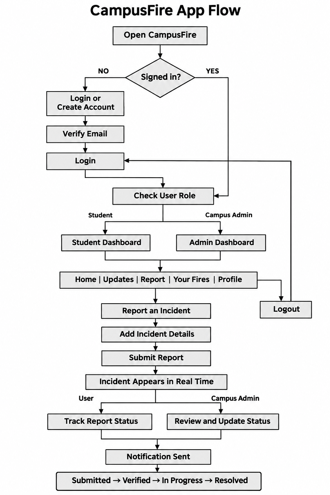

# CampusFire

## Formative 2, Mobile App Development

CampusFire is a mobile campus incident-reporting application developed for the Mobile App Development Formative 2 assignment.

The application allows verified members of the ALU community to report safety and facility incidents, view campus updates and follow the progress of submitted reports. Campus administrators have additional permission to review reports, update their status and remove fake or invalid reports.

**Author:** Helen Okereke  
**GitHub Repository:** [campus-incident-reporting-app](https://github.com/helen751/campus-incident-reporting-app)

---

## Main Features

### Features Available to All Users

- Create an account using an ALU email address.
- Verify the email address before signing in.
- Report a campus incident.
- Add the incident title, category, location and description.
- Optionally attach a photograph of the incident.
- Take a new photograph or select one from the device gallery.
- View incident updates in real time.
- Search reports by title, category, location or description.
- Filter reports by status.
- View incidents submitted by the signed-in user under Your Fires.
- Follow the progress of a submitted incident.
- Receive an in-app notification when a report status changes.
- View profile information and sign out.

### Additional Campus Admin Features

Campus administrators can use all the reporting features available to other users. They can also:

- Access an admin-focused dashboard.
- View incident totals and recent reports.
- Review full incident information.
- View the name and email of the person who submitted a report.
- See how many incidents the person has previously reported.
- Verify submitted reports.
- Update incident progress.
- Delete fake, duplicate or invalid reports.
- Search and filter all campus incidents.
- Receive real-time updates when new reports are submitted.

---

## Incident Progress

Every incident passes through the following stages:

1. **Submitted** — the incident has been sent to CampusFire.
2. **Verified** — a campus administrator has reviewed the incident.
3. **In Progress** — action is being taken on the incident.
4. **Resolved** — the incident has been handled.

Reports marked **In Progress** are displayed under the Verified filter because they have already been reviewed.

---

## Application Flowchart

The flowchart below shows how users and campus administrators move through CampusFire.



---

## Technologies Used

- Flutter
- Dart
- Firebase Authentication
- Cloud Firestore
- Provider
- Cloudinary (Image storage)
- Image Picker
- HTTP package
- Material Design

---

## State Management

CampusFire uses Provider to manage authentication states such as loading, success messages and error messages.

Firestore streams and `StreamBuilder` are used to display incidents and notifications in real time. This allows a report submitted or updated on one device to appear on another device without manually refreshing the application.

Local screen changes such as filters, search text, password visibility, navigation and animations are managed with `setState()`.

---

## Project Structure

```text
campus-incident-reporting-app/
├── android/
├── assets/
│   └── images/
├── docs/
│   └── campusfire_flowchart.png
├── ios/
├── lib/
│   ├── providers/
│   │   └── auth_provider.dart
│   ├── screens/
│   │   ├── admin_home_dashboard.dart
│   │   ├── dashboard_page.dart
│   │   ├── login_page.dart
│   │   ├── profile_page.dart
│   │   ├── report_page.dart
│   │   ├── signup_page.dart
│   │   ├── updates_page.dart
│   │   └── your_fires_page.dart
│   ├── widgets/
│   │   └── notification_bell.dart
│   ├── firebase_options.dart
│   └── main.dart
├── test/
├── firebase.json
├── firestore.rules
├── pubspec.yaml
└── README.md
```

---

## Requirements

Before running CampusFire, install:

- Flutter SDK
- Dart SDK
- Android Studio
- Android SDK
- An Android emulator or physical Android device
- Git
- Xcode and CocoaPods if running on iOS

Check the Flutter installation:

```bash
flutter doctor
```

Resolve any required issues reported by Flutter before running the project.

---

## Getting the Project

Clone the repository:

```bash
git clone https://github.com/helen751/campus-incident-reporting-app.git
```

Open the project directory:

```bash
cd campus-incident-reporting-app
```

Install the required packages:

```bash
flutter pub get
```

---

## Firebase Configuration

CampusFire uses Firebase Authentication and Cloud Firestore.

The repository contains the FlutterFire configuration files connected to the existing Firebase project:

```text
lib/firebase_options.dart
android/app/google-services.json
ios/Runner/GoogleService-Info.plist
```

Firebase is already configured in the project. If the included Firebase configuration is unavailable, connect the app to your own Firebase project using flutterfire configure.

```bash
dart pub global activate flutterfire_cli
```

Then configure the project:

```bash
flutterfire configure
```

In the Firebase Console, enable:

1. Firebase Authentication
2. Email/Password sign-in
3. Cloud Firestore

The Firestore security rules are stored in:

```text
firestore.rules
```

They can be deployed with:

```bash
firebase deploy --only firestore:rules
```

---

## Cloudinary Configuration

Incident photographs are uploaded to Cloudinary.

The Cloudinary configuration is found in:

```text
lib/screens/report_page.dart
```

The project uses:

```dart
static const String cloudName = '***** (hidden for security)';
static const String uploadPreset = 'campusfire_incidents';
```

Attaching an incident photograph is optional. 
A user can submit a valid incident report without selecting or taking an image.

---

## Running on Android

Start an Android emulator from Android Studio or connect a physical Android device with USB debugging enabled.

Check the available devices:

```bash
flutter devices
```

Run CampusFire:

```bash
flutter run
```

To use a specific device:

```bash
flutter run -d DEVICE_ID
```

CampusFire requires an internet connection because Firebase and Cloudinary are online services.

---

## Running on iOS

A Mac with Xcode installed is required.

Install the iOS packages if necessary:

```bash
cd ios
pod install
cd ..
```

Open the iOS Simulator:

```bash
open -a Simulator
```

Check the available devices:

```bash
flutter devices
```

Run CampusFire:

```bash
flutter run
```

The iOS configuration includes camera and photo-library permission descriptions so users can optionally attach photographs to incident reports.

---

## Creating an Account

CampusFire supports Student and Campus Admin accounts.

1. Open the signup page.
2. Select **Student** or **Campus Admin**.
3. Enter the email username.
4. CampusFire adds `@alustudent.com` to the username if Student or `@alueducation.com` if Staff.
5. Enter and confirm the password.
6. Create the account.
7. Open the verification email.
8. Verify the account.
9. Return to CampusFire and sign in.

Example:

```text
firstletter.lastname@alustudent.com
```

```text
staff.name@alueducation.com
```

Only users with verified ALU email addresses can access application data.

---

## Reporting an Incident

Any verified CampusFire user can report an incident. This includes both students and campus administrators because a staff member may also notice a problem that requires attention.

A report contains:

- Incident title
- Category
- Location
- Description
- Optional photograph
- Reporter information (Automatically stored by App)
- Submission date
- Current status

To submit a report:

1. Sign in with a verified Student or Campus Admin account.
2. Open the Report page.
3. Optionally take a photograph or select one from the gallery.
4. Fill the required fields
5. Submit the report.

The report is saved to Firestore and appears on other signed-in devices in real time.

---

## Search and Filtering

The Updates page supports searching by:

- Incident title
- Category
- Location
- Description

The page can also filter reports by:

- All
- Submitted
- Verified
- Resolved

The search works together with the selected status filter. For example, a user can select Verified and search for reports containing “water”.

Only five reports are shown at first. The user can select **View more** or **View less** to control the number displayed.

When no matching report is found, CampusFire displays a clear search-result message instead of the normal empty-updates message.

---

## Real-Time Updates

CampusFire uses Firestore snapshot streams.

When a verified user submits a report:

1. The report is stored in Firestore.
2. The Updates page receives the new data.
3. The admin dashboard updates.
4. Other signed-in devices display the report without restarting or refreshing.

When an administrator changes an incident status, the reporter’s application receives the updated status through the same real-time connection.

---

## Notifications

CampusFire provides in-app notifications.

The notification badge increases when:

- another user submits an incident; or
- an administrator changes the status of a user’s report.

Opening the notification marks the update as read and reduces the unread count.

The application also plays a system alert and vibration when a new update arrives while CampusFire is open.

These are foreground in-app notifications. They are not background push notifications when the application is completely closed.

---

## Firestore Collections

### Users

The `users` collection stores:

```text
fullName
email
role
status
createdAt
```

### Incidents

The `incidents` collection stores:

```text
id
title
category
location
description
imageUrl
imagePublicId
reportedBy
reporterName
reporterEmail
status
createdAt
updatedAt
updatedBy
readBy
```

The image fields can be empty because attaching a photograph is optional.

### Notifications

The `notifications` collection stores:

```text
userId
incidentId
title
message
type
isRead
createdAt
```

---

## Firestore Security

The Firestore rules ensure that:

- Users must be signed in.
- Users must verify their email before accessing application data.
- Student accounts use `@alustudent.com`.
- Campus Admin accounts use `@alueducation.com`.
- All verified users can submit incident reports.
- Reports are connected to the account that submitted them.
- Ordinary users cannot change incident statuses.
- Users can only mark reports and their notifications as read.
- Campus administrators can submit their own reports.
- Campus administrators can review and update incident statuses.
- Campus administrators can delete fake or invalid reports.

---

## Testing the Main Workflows

### General Reporting Workflow

1. Create and verify a Student or Campus Admin account.
2. Sign in.
3. Open the Report page.
4. Submit an incident with or without a photograph.
5. Confirm that the report appears on the Updates page.
6. Confirm that it appears under Your Fires.
7. Search for the report using its title, category or location.
8. Filter the report using its current status.
9. Open the incident and view its progress.

### Campus Admin Management Workflow

1. Create and verify a Campus Admin account.
2. Sign in on another emulator or physical device.
3. Confirm that a newly submitted report appears without refreshing.
4. Open the incident details.
5. View the reporter information.
6. Update the report to Verified.
7. Update it to In Progress.
8. Update it to Resolved.
9. Confirm that the reporter receives the updates.
10. Test deleting a fake report.

Using two devices or emulators demonstrates the real-time synchronization between users and campus administrators.

---


## Common Problems

### Packages Are Missing

Run:

```bash
flutter clean
flutter pub get
```

Then restart the application.

### Firebase Does Not Initialize

Confirm that these files exist:

```text
lib/firebase_options.dart
android/app/google-services.json
ios/Runner/GoogleService-Info.plist
```

### Firestore Permission Is Denied

Confirm that:

- the user is signed in;
- the user has verified their email;
- the Firestore rules have been published;
- the user document has the correct role;
- the user document has an active status.

### A Photograph Does Not Upload

Confirm that:

- the device has an internet connection;
- the Cloudinary upload preset is unsigned;
- the Cloudinary configuration matches `report_page.dart`;
- camera or photo-library permission has been granted.

Remember that attaching a photograph is optional. A report can still be submitted without one.
---

## Author

**Helen Okereke**

Mobile App Development (Formative 2)

GitHub: [helen751](https://github.com/helen751)

Repository: [CampusFire](https://github.com/helen751/campus-incident-reporting-app)

---

## License

This project was created by Helen Okereke for educational purposes as part of the Mobile App Development Formative 2 assignment.